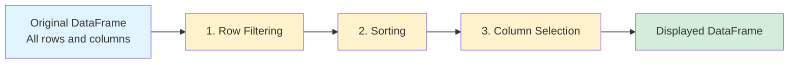

# Sorting and Filtering DataFrames (pandas)

## Order of Operations

The order of operations (sort then filter vs. filter then sort) can produce different results:

### 1. Filtering removes rows that affect sorting with `na_position`

```python
import pandas as pd
import numpy as np

df = pd.DataFrame({'A': [1, 2, np.nan, 4]})

# Sort then filter (NaN was placed last, then removed)
df_A = df.sort_values('A', na_position='last').query('A.notna()')

# Filter then sort (NaN removed before sorting)
df_B = df.query('A.notna()').sort_values('A')

# Results are the same values, but the row order/indices differ
```

### 2. Filtering based on rank/position after sorting

```python
df = pd.DataFrame({'value': [30, 10, 50, 20, 40]})

# Sort then filter (top 3 after sorting)
df_A = df.sort_values('value').head(3)  # [10, 20, 30]

# Filter then sort (values < 35, then sorted)
df_B = df[df['value'] < 35].sort_values('value')  # [10, 20, 30]

# In this case same, but with different threshold:
df_A = df.sort_values('value').head(3)  # [10, 20, 30]
df_B = df[df['value'] < 25].sort_values('value')  # [10, 20]
```

### 3. Filtering with duplicate-sensitive conditions

The **columns remain the same**, but the **row indices and values can differ** when:
- Filters depend on row position or relative ordering
- Using rank-based filters after sorting
- Working with duplicates and using `keep` parameters

However, for simple value-based filters (like `A > 5`), the operations are **commutative** and produce identical results.

---

## DataFrame Viewer

In the context of a DataFrame viewer, the behavior and user expectations differ from programmatic pandas usage.

### Viewer Capabilities

- **Sorting** = User can sort rows based on any visible column
- **Filtering** = User can hide/exclude specific rows and columns from the DataFrame display
- **Re-sorting** = User can re-sort after filtering, but only using non-hidden (visible) columns

Operations are applied in a logical order:


Pipeline is re-executed whenever user changes filter or sorting.