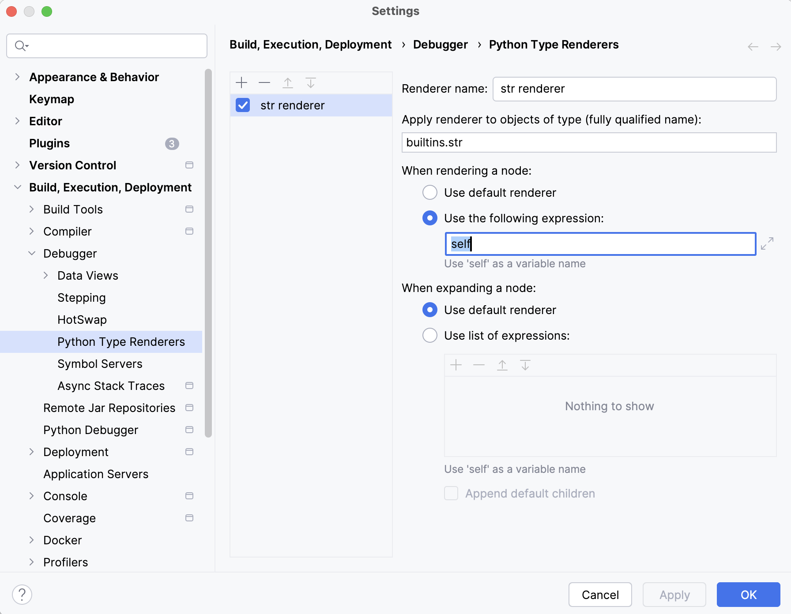

## Problem
PyCharm versions `>= 2024.2.1` and `< 2025.1.0` have several bugs which makes the plugin unusable.
The plugin isn't able to fetch the required data from the underlying Python process and stays empty or fails directly.

## Workaround
The workaround depends on your used plugin version:
- **[Plugin v0.20.0 and later](#for-plugin-version-v0200-and-later)** - configure custom type renderers for serialization types
- **[Plugin v0.19.0 and earlier](#for-plugin-version-v0190-and-earlier)** - configure custom type renderer for `builtins.str`

More general information about `Python Type Renderers` can be found here:
https://www.jetbrains.com/help/pycharm/customizing-views.html
---

### For Plugin Version v0.20.0 and Later

> [!IMPORTANT]
> Only applicable when using PyCharm `>= 2024.2.1` and `< 2025.1`

In v0.20.0 of the plugin, the serialization of the fetched data was reworked.
Instead of configuring a custom type renderer for `builtins.str`, you need to configure custom type renderers for the new introduced serialization types.

These steps have only to be done once to configure these renderers.
Afterward the plugin works again as expected.

#### Related Bug
This workaround addresses the following PyCharm bug:
- [PY-77038: repr value is truncated on copy](https://youtrack.jetbrains.com/issue/PY-77038)

#### Steps
- start a debug process
- evaluate an empty string `""`
- right-click at the evaluated result and select `Customize Data View` from the context menu
- the `Python Type Renderers` page of `Settings` with a new renderer opens. Configure it similarly to the v0.19.0 approach, but create a separate custom type renderer for each of the following types:
    - `cms_rendner_sdfv.base.serialization.ResultJsonString`
    - `cms_rendner_sdfv.base.serialization.ExceptionJsonString`

---

### For Plugin Version v0.19.0 and Earlier

> [!IMPORTANT]
> Only applicable when using PyCharm `>= 2024.2.1` and `< 2024.2.3`

As the plugin only loads the required data in the form of strings, you can easily configure a `custom type renderer` for `builtins.str` as a temporary workaround.
These steps have only to be done once to configure such a renderer.
Afterward the plugin works again as expected.

#### Related PyCharm Bug
This workaround addresses the following PyCharm bug:
- [PY-75568: Large strings truncated when displayed in debug output or evaluate windows again](https://youtrack.jetbrains.com/issue/PY-75568)

#### Steps
- start a debug process
- evaluate an empty string `""`
- right-click at the evaluated result and select `Customize Data View` from the context menu
- the `Python Type Renderers` page of `Settings` with a new renderer opens. Configure it as shown in the screenshot:

